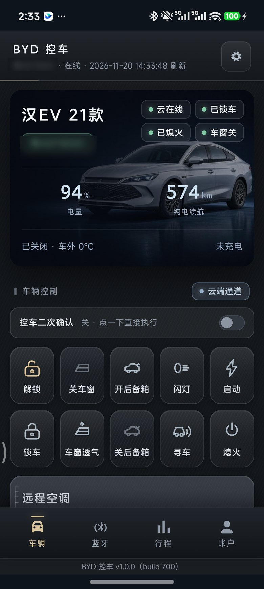
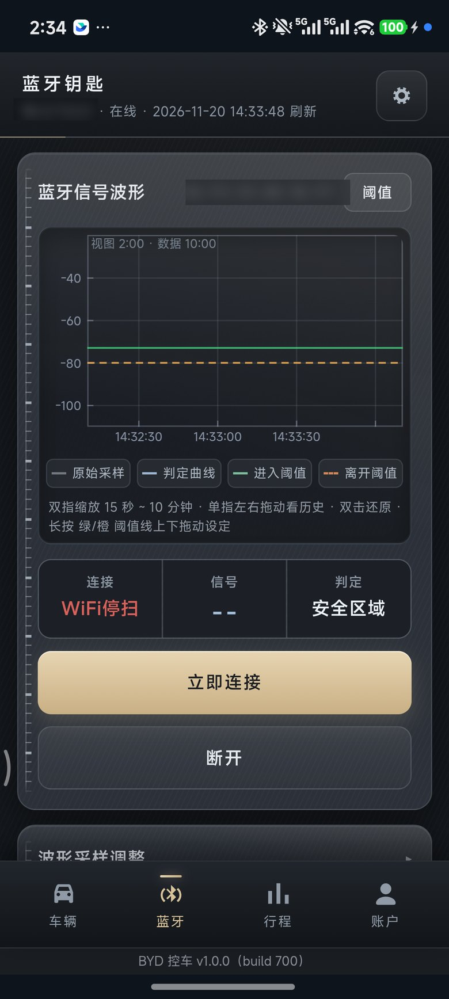
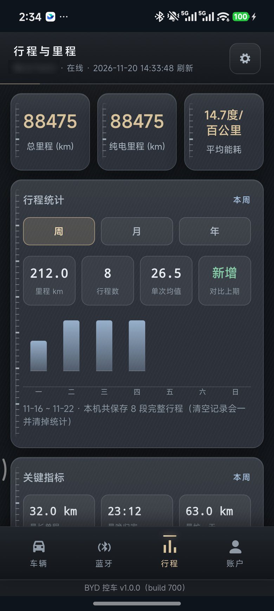
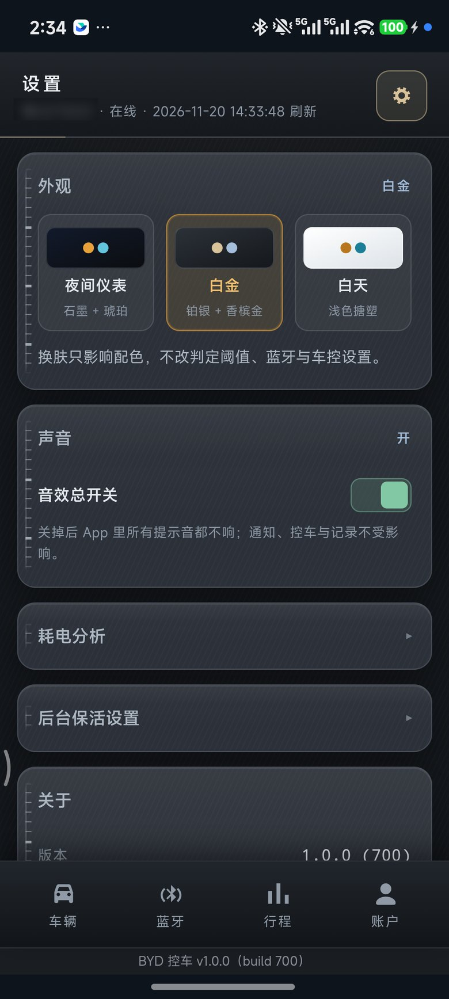

# byd-kongche-clean · 1.0.0

> 这是一个**自用**的 Android 车控 App 本地改造工程（补丁流水线），**只发布源码，不提供任何 APK / Release 产物**。
> 想用就自己按下面的步骤构建。构建产物只留在你自己机器上。

原始 App 是第三方做的比亚迪车控工具（BLE 数字钥匙 + 云端车况/控车）。本仓库不含原始 APK，
也不分发任何二进制；`patcher/` 里是对**你自备的那份原始安装包**做静态改造的脚本。


## 界面预览

> 截图来自本工程构建出的包；**车牌、车机 MAC 已打码**，车辆数据为真实读数但已无可识别信息。

| 车辆（控车 + 车况） | 蓝牙（波形 + 阈值 + 停扫原因） |
|---|---|
|  |  |

| 行程（周/月/年统计 + 上次充电） | 设置（外观 / 声音 / 关于） |
|---|---|
|  |  |

---

## 一、先读这段（防御性说明）

1. **自行构建、自行承担风险。** 仓库里没有安装包，任何声称「从这个仓库下载的 APK」都不是我发的。
2. **仅限个人在自己的车上使用。** 不要用于商业用途、不要用于他人车辆、不要把改造后的包拿去分发或售卖。
3. **不绕过任何付费/授权。** 本工程不解锁原 App 的付费功能，不做账号共享，不伪造授权；车控能力仍走你自己的比亚迪账号与官方云端。
4. **车辆安全第一。** 控车指令会真实作用于车辆（解锁、上锁、后备箱、空调、启动/熄火）。**不要在行驶中操作**，不要在人多/坡道/儿童附近做实验；先用「控车二次确认」开关把自己保护起来。
5. **可能违反原 App 的用户协议。** 改造第三方客户端存在被判定异常、账号受限、失去原厂保修等风险，这些后果由使用者自负。
6. **不保证兼容。** 原 App 升级、车机固件升级、Android 版本差异都可能让补丁失效或行为异常；上车前先在空旷处静止验证。
7. **不收集你的任何数据。** 本工程没有任何上传/上报通道（见下），日志只落在本机 `Download/`。
8. **法律与合规由使用者负责。** 不同地区对车辆控制类软件的改造有不同规定，请自行确认。

---

## 二、这一版去掉了什么

### 1) 巴法云（整套移除）

| 移除项 | 说明 |
|---|---|
| 巴法云 MQTT 通道 | 原 App 用巴法云把车况推到米家/小爱，并从云端接指令。本版**不建立任何 MQTT 连接、不订阅、不发布** |
| 「小爱卡片」设置卡 | 账户页里选卡、建卡、同步、自定义卡的整块 UI 与弹层全部删除 |
| 云同步 / 云备份 | 依赖巴法云的「配置上云 / 从云恢复」一并失效并移除入口 |

理由：巴法云那条链路会把车况与指令经第三方服务器中转，且需要额外的 UID 配置。本版只保留**本机 ↔ 比亚迪官方云 / 本机 ↔ 车机 BLE** 两条路。

### 2) 锁屏媒体卡片

原 App 会挂一个 MediaSession，让锁屏出现一张「音乐播放器」样式的卡片，四个媒体键被映射成解锁/上锁等动作。本版：

- 设置里的「卡片中心 · 锁屏媒体卡片」整卡删除；
- 原生 `MediaSession.setActive(true)` 被改为 `false`，**锁屏不再出现媒体控制条**，媒体键也不再触发车控。

### 3) 日志上传（本工程不含这个功能）

原 App 本身就有「导出日志」的能力，本工程**保留导出、不做任何上传**：

- 工程早期曾自己加过一版「加密上传日志到 NAS」，**已经彻底删除**：`SecureUpload` / 固定证书 /
  upload token / 上传调度全部移除，`LogUploader` 的上传地址被置空（`emptyList`）、`postOne` 直接返回失败；
- 现在唯一与日志有关的入口是「关于」卡里的 **导出日志压缩包**：把运行日志 + 本机设置打成 zip
  落到 `Download/`，你自己看或发给朋友；
- 源码里没有任何服务器地址、证书或 token，产物校验里也会断言包内不含内网地址。

### 4) 自动更新 / 检查更新 / 更新日志

- `UpdateChecker.updateUrls()` 返回空列表 ⇒ **启动不再联网查更新**；
- 设置页「检查更新」按钮、「启动时自动检查一次…」文案、整张「更新日志」卡全部删除；
- 「关于」卡只保留 **版本号** 与 **性质**。

### 5) 桌面图标切换

原 App 允许在设置里切换三套图标/自定义图片。本版删除该卡，**固定使用包里那套白色图标**。

### 6) 作者信息与采样功能

- 制作者 / 抖音号 / 联系方式 / 「关于作者」弹层：删除；
- 早期版本里的「校准采样」（`Calibration` 系列 UI、桥方法与原生类）：整套删除。

---

## 三、这一版保留了什么

**车控与连接**

- BLE 数字钥匙：直连、握手、保活守护、后台常驻、开机自启；
- 云端车况与云端控车（仍走你自己的比亚迪账号，扫码授权钥匙可用）；
- 控车动作：解锁 / 上锁 / 后备箱 / 车窗 / 空调 / 闪灯 / 寻车 / 启动 / 熄火等；
- **控车二次确认**开关（点按钮先弹确认框，防误触）。

**蓝牙信号与判定**

- 实时波形（原始采样 / 判定曲线 / 进入·离开阈值线，可缩放拖动）；
- **阈值精确设定**：设置按钮 + 数字输入（进入/离开阈值，带迟滞校验），与长按拖动并存；
- 波形「连接」格直接显示 `WiFi停扫 / 定时停扫` 等停扫原因；
- 通道指示牌（云端通道 / 蓝牙直连，点开解释走哪条路、大概多久）。

**行程与统计**

- 行程记录（上电→熄火记一段，含蓝牙/云端、成功失败、耗时）；
- **周 / 月 / 年统计**：里程、行程数、单次均值、对比上期 + 柱状图；
- **关键指标**：最长单程、最晚归家、最忙一天、出行天数、单次里程、日均里程；
- **上次充电**：从多少充到多少、充完后已开多远（默认用本机每 20 秒观察估算；若要精确到秒的起止时刻，见文末「关于通知权限」，需自行开启可选组件）。

**外观与其它**

- 换肤：夜间仪表 / 白金 / 白天（设置页「外观」，状态存本机）；
- 声音总开关（设置页「声音」）；
- 后台保活设置、耗电分析；
- 通知监听（**仅**读取比亚迪官方 App 的充电通知，见下）。

**隐私边界**

- 无任何日志上传；导出是本地 zip
- 通知监听只处理 `com.byd.aeri.caranywhere`，其它 App 的通知一律丢弃；比亚迪的非充电消息也丢弃；
- 落盘只有时间戳与类型（`marks`），最多留 6 条匹配到的原文用于排错，界面上可一键清空；
- 不联网、不上传、不写外部存储、不进日志。

---

## 四、目录结构

```
patcher/
  build_secure.py        # 主构建脚本：apktool 反编译 → 打补丁 → javac/d8 → 重打包 → 签名
  ui_patch.py            # 网页层改造（顶栏、设置页、行程统计、充电块、换肤……）
  ui_v4_patch.py         # 4.x 皮肤注入（v4.css / v4-platinum.css / skin.js）
  baseline_patch.py      # 凭据初始化与一次性迁移
  reliability_patch.py   # 稳定性补丁（WatchApiClient 幂等等）
  bemfa_patch.py         # 巴法云加固层（把相关 UI 变成不可用空壳，最终由 ui_patch 摘除）
  verify_artifact.py     # 产物校验（签名、CSP、关键 id、版本号、无内网地址）
  assets/                # 注入用的 CSS / JS / HTML 片段
  src/                   # 自己编译进 classes3.dex 的 Java 类
  tests/                 # 纯 Python/Node 的回归测试（46 项）
```

## 五、自行构建

前置：

- Windows + JDK 11（`javac` 可用）
- Android SDK：`platforms/android-34/android.jar`、`build-tools`（含 `zipalign`）
- apktool（2.11.x）
- 一份**你自己合法取得**的原始安装包，命名为 `BYD-kongche_3.20.83.apk`，放在仓库根目录（脚本按这个文件名找它）
- 一个自己的签名 keystore（脚本默认读 `patcher/.trial.keystore`，自己换掉）

```bash
python patcher/build_secure.py      # 产出 patcher/dist/*.apk
python patcher/verify_artifact.py   # 校验产物
python -m unittest discover -s patcher/tests -p "test_*.py"   # 回归测试
```

脚本里的绝对路径（JDK / SDK / apktool / keystore）请按自己的机器改。

---

## 附：关于「通知权限」（通知使用权）

「行程」页的「上次充电 · 从 X% 充到 Y%、之后开了多远」有两种取时刻的办法，**默认只用第二种**：

### 两条路

| 方式 | 精度 | 需要什么 |
|---|---|---|
| 本机观察（默认，始终启用） | 20 秒轮询，误差几分钟 | 什么都不用给 |
| 官方 App 通知（可选，默认**不编译**） | 精确到秒 | 手机上的 Android「通知使用权」授权给本 App |

车况接口只给「此刻」的电量与总里程，**不提供历史**；充电开始/结束的准确时刻只能靠官方 App
的推送（它走 MiPush「车辆消息」通道）或者本机轮询估算。

### 这个工程里它是**可选组件**，默认不构建

`ChargeNotify`（NotificationListenerService）与 `ChargeApi`（JS 桥）放在
`patcher/src_optional/charge_notify/`，**默认不参与编译、不写进 AndroidManifest**。
也就是说：从本仓库直接构建出来的包，**根本不存在通知监听组件**，系统「通知使用权」里也看不到它，
更不会读任何通知。

要启用（想拿到精确的充电起止时刻）：

```bash
# Windows PowerShell
$env:KC_CHARGE_NOTIFY=1; python patcher/build_secure.py
# bash
KC_CHARGE_NOTIFY=1 python patcher/build_secure.py
```

开启后才会：注入 `<service … BIND_NOTIFICATION_LISTENER_SERVICE>`、在 `MainActivity.onCreate`
注册 `window.KCCharge`，页面里也才会出现「开启通知读取」那颗按钮。

### 如果启用了：它到底读什么

- **只处理** `com.byd.aeri.caranywhere`（比亚迪官方 App）的通知；包名不匹配**第一行就 return**，
  不解析、不落盘、不留痕；
- 即使是官方 App 的通知，也要过「充电关键词」才记：`开始充电 / 插枪 / 停止充电 / 充电完成 / 拔枪 …`，
  开锁、OTA、消毒这类车辆消息**直接丢弃**；
- 落盘只有 `{时间戳, 类型(start/stop/done)}`，最多 120 条；另留最近 **6 条**匹配到的通知原文
  （各截断 40 字）**仅用于文案对不齐时排错**，界面上有「清空充电记录」可一键清掉；
- **不联网、不上传、不写外部存储、不进日志。**

### 怎么授权 / 怎么撤销

- 授权：系统设置 →「通知使用权 / 通知读取权限」→ 找到「BYD 控车」→ 允许；
  或点行程页充电块里的「开启通知读取」直接跳过去。
  （Android 各家的入口名称不一样：小米叫「通知使用权」，原生叫「通知读取权限」。）
- 撤销：同一个页面把开关关掉即可；关掉之后本 App 再也收不到任何通知，充电时刻退回轮询估算。
- ⚠ 每次覆盖安装 APK，系统可能把这笔授权重置 —— 重新打开一次开关就行。

### Android 的边界（必须知道）

「通知使用权」是**整机级**授权：一旦允许，系统会把**所有** App 的通知都递给这个监听服务，
Android 没有「只允许读某个包」的开关。所以隔离只能靠代码——本工程的隔离方式就是上面那段包名判断。
如果你不接受这个模型，**不要启用该组件**（默认就是不启用的），功能仍然可用，只是充电时刻变成估算。

## 六、许可

源码以「自用改造脚本」形式公开，供学习与自己构建使用；不提供任何担保。
原始 App 的版权归其作者与比亚迪所有，本仓库不包含原 App 的任何二进制。

## 作者

minwei35（YG）· 自用改造，按 MIT 之外的方式随意参考；原 App 版权归原作者与比亚迪所有。
