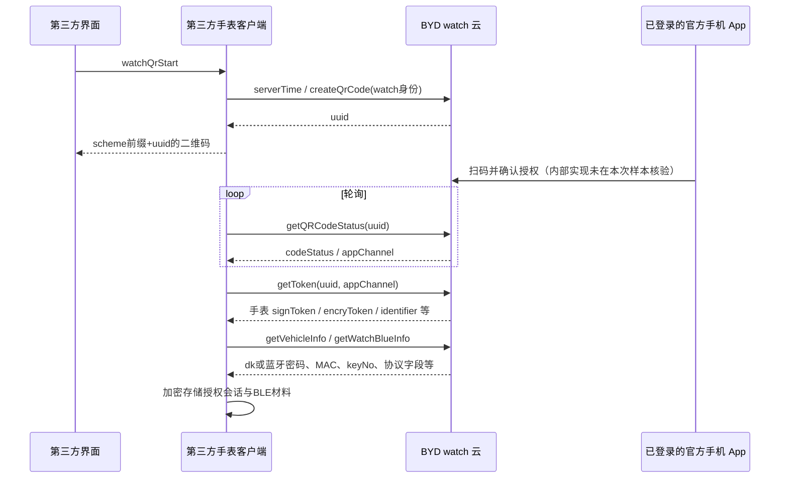

# 第三方扫码授权、官方登录共存与蓝牙速度调查报告

日期：2026-11-16。范围：已落盘第三方 3.20.83 REA/JADX/smali，以及当前 Clean 与其实际复用的 byd-keyless 服务源码。未安装、未控车、未发网络登录请求、未读取真实账号凭据；扫码链路以静态代码及 smali 核对为主；父代理另只读采集既有真机日志核实当前认证模式与耗时，未重新并发登录实测。

## 结论

1. **扫码是官方 App 授权一个独立的手表端会话**：第三方自己申请 UUID，展示 `watchQRCode://yangwang=SEC_PRE` + UUID，由官方 App 扫描并确认；第三方随后轮询、兑换 token，再拉车辆/蓝牙材料。二维码不是 dk、不是手机号密码、不是官方手机 token 的拷贝。
2. **官方手机登录和第三方扫码登录走不同会话协议**。手机侧密码登录落在 superapp 域 `/app/auth/login`；第三方扫码落在 watch 域 `watch/watchApp/login/watchLogin/*`，有独立 watchImei、appChannel、identifier 等身份。用户观察到两 App 共存，与这种分轨实现吻合；服务端并发策略没有在本次执行中实测，不能上升成“永远互不影响”。代码还明确处理手表会话被其他设备顶掉的 `9001`。
3. **不需要把实体手表当成实现前提**：第三方的 watchImei 来自本机 `SecureRandom` 的 32 字节 Base64，型号/名称默认 WATCH，品牌默认 byd。这里是软件实现手表客户端协议；是否对所有车型/账号都能获批属于另一个问题。
4. **Clean 已有密码学基础设施，却未接完整扫码授权业务**：当前 WatchSelfTest 只是打印端点/字段，Java 云业务走内网服务，服务再用用户名密码登录 superapp；dk/watchPwd 仍由设置入口写入，探测回调没有把有效钥匙提取并持久化。
5. **扫码不直接使 BLE 变快**：它解决正确凭据、地址、槽位、协议族来源，并支持缓存。蓝牙速度主要取决于认证后的连接复用与调度，不是每次重新扫码或每次登录。父代理另有当前常连/重建连接的精确性能证据，最终报告应合并。

## 1. UI 与二维码真实载荷

- UI 按钮 `btnKeySync` 点击始终先 `openWatchQr()`，已有授权时另行尝试静默刷新；`openWatchQr` 先取消上一轮再调用原生 `watchQrStart`。来源：[app.js:3491–3527](<C:/Users/KURO/Desktop/soft/ai相关/byd-kongche/rea/apktool/assets/ui/app.js#L3491-L3527>)。
- 原生桥注册 onEvent，把状态推送为 `onWatchQr`，随后调用 `WatchQrService.start(context)`。来源：[WebBridge.java:8397–8423](<C:/Users/KURO/Desktop/soft/ai相关/byd-kongche/rea/jadx/sources/com/qinl/car/pub/wui/WebBridge.java#L8397-L8423>)。
- `flow()` 的 JADX 输出是 `Method not decompiled`，所以主流程以 smali 为准，而不是补猜 Kotlin。来源：[WatchQrService.java:285–309](<C:/Users/KURO/Desktop/soft/ai相关/byd-kongche/rea/jadx/sources/com/qinl/car/pub/cloud/WatchQrService.java#L285-L309>)。
- 每轮新建 WatchApiClient，校时后申请二维码，读取 `uuid`。来源：[WatchQrService.smali:3090–3165](<C:/Users/KURO/Desktop/soft/ai相关/byd-kongche/rea/apktool/smali_classes2/com/qinl/car/pub/cloud/WatchQrService.smali#L3090-L3165>)。
- 实际字符串是前缀直接拼 UUID，再本地渲染 PNG，提示用官方 App 扫。来源：[WatchQrService.smali:3279–3337](<C:/Users/KURO/Desktop/soft/ai相关/byd-kongche/rea/apktool/smali_classes2/com/qinl/car/pub/cloud/WatchQrService.smali#L3279-L3337>)。

**校验边界**：第三方是二维码生成/展示端，而非官方扫码解析端。在已查主线中没有扫描任意第三方二维码并本地校验其内容的逻辑；UUID 有非空判断、轮次与过期处理。官方 App 如何解析 scheme、确认账号、校验 UUID/绑定设备，属于本样本之外的官方端/服务端行为，暂列待验证。

## 2. 轮询、兑换与凭据来源

- 轮询窗口常量 110 秒，间隔 2500 ms，最多 6 轮：[WatchQrService.java:62–66](<C:/Users/KURO/Desktop/soft/ai相关/byd-kongche/rea/jadx/sources/com/qinl/car/pub/cloud/WatchQrService.java#L62-L66>)。实际分支见 [smali:3440–3563](<C:/Users/KURO/Desktop/soft/ai相关/byd-kongche/rea/apktool/smali_classes2/com/qinl/car/pub/cloud/WatchQrService.smali#L3440-L3563>)。
- `codeStatus` 用于变化日志；**进入 confirm 的实际成功判据是客户端 appChannel 非空**，不是在这段里硬编码某个 codeStatus 值。[smali:3468–3536](<C:/Users/KURO/Desktop/soft/ai相关/byd-kongche/rea/apktool/smali_classes2/com/qinl/car/pub/cloud/WatchQrService.smali#L3468-L3536>)。
- 超时换新码；确认后 `getToken(uuid)` 最多尝试 3 次，异常间隔 2 秒。[smali:3630–3737](<C:/Users/KURO/Desktop/soft/ai相关/byd-kongche/rea/apktool/smali_classes2/com/qinl/car/pub/cloud/WatchQrService.smali#L3630-L3737>)、[smali:3798–3828](<C:/Users/KURO/Desktop/soft/ai相关/byd-kongche/rea/apktool/smali_classes2/com/qinl/car/pub/cloud/WatchQrService.smali#L3798-L3828>)。
- 域名与端点常量：[WatchApiClient.java:45–64](<C:/Users/KURO/Desktop/soft/ai相关/byd-kongche/rea/jadx/sources/com/qinl/car/pub/cloud/WatchApiClient.java#L45-L64>)。
- `createQrCode` 发送 watch 基础信息；status/getToken 的业务明文入参包含 UUID；未登录阶段以 watchImei 作为业务加密/签名依据，status 响应更新 appChannel。[WatchApiClient.java:459–473](<C:/Users/KURO/Desktop/soft/ai相关/byd-kongche/rea/jadx/sources/com/qinl/car/pub/cloud/WatchApiClient.java#L459-L473>)、[571–599](<C:/Users/KURO/Desktop/soft/ai相关/byd-kongche/rea/jadx/sources/com/qinl/car/pub/cloud/WatchApiClient.java#L571-L599>)。
- **signToken/encryToken 等来自 getToken 后端解密响应**，随后更新实例 identity/channel/brand/version/passWord/support 等字段。[WatchApiClient.java:588–687](<C:/Users/KURO/Desktop/soft/ai相关/byd-kongche/rea/jadx/sources/com/qinl/car/pub/cloud/WatchApiClient.java#L588-L687>)。`passWord` 这个响应字段不能仅凭命名等同用户输入的账号密码。
- 登录后 `bodyLoginParams` 使用 encryToken 加密，signToken 签名（缺 signToken 才退 watchImei），加入 identity/channel；车辆/蓝牙业务响应使用 encryToken 解密。[WatchApiClient.java:480–546](<C:/Users/KURO/Desktop/soft/ai相关/byd-kongche/rea/jadx/sources/com/qinl/car/pub/cloud/WatchApiClient.java#L480-L546>)、[697–710](<C:/Users/KURO/Desktop/soft/ai相关/byd-kongche/rea/jadx/sources/com/qinl/car/pub/cloud/WatchApiClient.java#L697-L710>)。
- `buildWatchSign` 排序字段、排除 sign、追加 password=signKey，再 HMAC-SHA256；这里 password 是签名拼接字段，不等于账号密码。[WatchCipher.java:108–120](<C:/Users/KURO/Desktop/soft/ai相关/byd-kongche/rea/jadx/sources/com/qinl/car/pub/cloud/WatchCipher.java#L108-L120>)。
- HTTP 外面再包 `WatchChan.b`，响应先 `WatchChan.c` 解外层、再解业务 AES 层：[WatchApiClient.java:349–350](<C:/Users/KURO/Desktop/soft/ai相关/byd-kongche/rea/jadx/sources/com/qinl/car/pub/cloud/WatchApiClient.java#L349-L350>)、[383–438](<C:/Users/KURO/Desktop/soft/ai相关/byd-kongche/rea/jadx/sources/com/qinl/car/pub/cloud/WatchApiClient.java#L383-L438>)。

## 3. 手表身份不等于手机设备身份

默认构造器调用 `newWatchImei()`，其实现生成 32 个随机字节后 Base64 编码；默认 watchModel=WATCH、watchBrand=byd、watchName=WATCH：[WatchApiClient.java:244–263](<C:/Users/KURO/Desktop/soft/ai相关/byd-kongche/rea/jadx/sources/com/qinl/car/pub/cloud/WatchApiClient.java#L244-L263>)。这证明此客户端没有从实体手表读硬件 IMEI 的前置流程。

扫码后，sessionJson 保存 watch_imei、sign_token、encry_token、app_channel、identifier、identifier_type、objective、vehicle_brand 等：[WatchQrService.java:852–879](<C:/Users/KURO/Desktop/soft/ai相关/byd-kongche/rea/jadx/sources/com/qinl/car/pub/cloud/WatchQrService.java#L852-L879>)。静默刷新恢复原 watch_imei 与 token 身份，直接再取材料，不重新输入手机账号密码：[WatchQrService.java:960–1038](<C:/Users/KURO/Desktop/soft/ai相关/byd-kongche/rea/jadx/sources/com/qinl/car/pub/cloud/WatchQrService.java#L960-L1038>)。

## 4. BLE 材料与持久化

- 授权后分别尝试 `vehicleInfo()`、`watchBlueInfo()`；递归提取多组字段别名，两个端点互补，而非只认单一固定返回结构：[WatchQrService.java:392–461](<C:/Users/KURO/Desktop/soft/ai相关/byd-kongche/rea/jadx/sources/com/qinl/car/pub/cloud/WatchQrService.java#L392-L461>)。
- dk 候选：dk / bluetoothDk / watchBlueToothKey / empowerBluetoothKey；legacy 密码：blueToothPassword 等；同时获取 authBluetoothProtocol、authBluetoothProtocolState、bluetoothMacAddress、empowerBluetoothKeyNo、vin、车主号码候选。它们是**后端授权业务响应字段**，不是二维码直接载荷。
- `saveWatchAuth` 把非空 dk 同步写到 BLE_DK_KEY/BLE_KA_KEY/BLE_KD_KEY；另存 token、槽位、MAC、VIN、userId、watchImei。[CredentialManager.java:319–349](<C:/Users/KURO/Desktop/soft/ai相关/byd-kongche/rea/jadx/sources/com/qinl/car/pub/CredentialManager.java#L319-L349>)。
- 另外保存真实蓝牙密码、ownerPhone/号码候选、目标 MAC、协议族及状态、session JSON：[WatchQrService.java:668–789](<C:/Users/KURO/Desktop/soft/ai相关/byd-kongche/rea/jadx/sources/com/qinl/car/pub/cloud/WatchQrService.java#L668-L789>)。存储层是 AndroidX EncryptedSharedPreferences，MasterKey AES256_GCM，pref key SIV / value GCM：[CredentialManager.java:99–103](<C:/Users/KURO/Desktop/soft/ai相关/byd-kongche/rea/jadx/sources/com/qinl/car/pub/CredentialManager.java#L99-L103>)。
- **扫码不等于一定 DK 模式**：新模式实际判据要求 authProto=1、authProtoState=1、BLE_KA_KEY 非空；有显式 legacy/dk 开关的优先覆盖：[CredentialManager.java:304–316](<C:/Users/KURO/Desktop/soft/ai相关/byd-kongche/rea/jadx/sources/com/qinl/car/pub/CredentialManager.java#L304-L316>)。
- legacy 密码优先用云端蓝牙密码 Hex/Base64 解出的前14字节，最后才用账号密码 fallback：[LegacyBleFrames.java:359–395](<C:/Users/KURO/Desktop/soft/ai相关/byd-kongche/rea/jadx/sources/com/qinl/car/pub/bluetooth/LegacyBleFrames.java#L359-L395>)。所以“填了账号密码”和“拿到车端认可的蓝牙口令”不是同一件事。

## 5. Clean 与实际登录实现比较

| 项目 | 第三方扫码 | 当前 Clean |
|---|---|---|
| 手机端入口 | 展示码供官方 App 扫 | 保存 phone/password、调用本地链或内网服务 |
| 凭据获取 | UUID→官方确认→watch token→材料接口 | 账号密码→服务 superapp 登录→接口探测 |
| 后端域 | dilinkwatchapp-cn.byd.auto | dilinksuperappserver-cn.byd.auto |
| 身份 | 随机 watchImei + 后端 identifier/channel | DeviceProfile 手机字段 + username、superId/userId |
| token 存储 | 手机加密偏好保存完整 watch session | 服务进程内常驻 BydClient；手机存自有服务 X-Auth |
| BLE材料落地 | 自动保存 dk、蓝牙密码、MAC、keyNo、协议字段 | ble_key/watch_pwd 已有 Keystore 存储，但主要靠 extra 手工写入 |

证据：

- Clean 云调用 `/ble/keyprobe` 发送 username/password/vin，X-Auth 是自有服务鉴权，不是 BYD watch token：[BydCloud.java:67–83](<C:/Users/KURO/Desktop/soft/ai相关/ai-workspace/byd-kongche-clean/src/com/byd/kc/BydCloud.java#L67-L83>)、[135–146](<C:/Users/KURO/Desktop/soft/ai相关/ai-workspace/byd-kongche-clean/src/com/byd/kc/BydCloud.java#L135-L146>)。
- 真实服务位于 [server.py:63–82](<C:/Users/KURO/Desktop/soft/ai相关/ai-workspace/byd-keyless/pc-service/server.py#L63-L82>)；实际厂商登录是 [client.py:198–258](<C:/Users/KURO/Desktop/soft/ai相关/ai-workspace/byd-keyless/pc-service/vendor/pybyd_china/client.py#L198-L258>) 的 `/app/auth/login`，登录返回 token 构造进程内 BydSession：[client.py:269–305](<C:/Users/KURO/Desktop/soft/ai相关/ai-workspace/byd-keyless/pc-service/vendor/pybyd_china/client.py#L269-L305>)。域名见 [config.py:13](<C:/Users/KURO/Desktop/soft/ai相关/ai-workspace/byd-keyless/pc-service/vendor/pybyd_china/config.py#L13>)。
- 服务注释明确重复 login 会顶掉上一会话(code22)，所以常驻复用 BydClient；这是源码设计陈述，非此次并发复现：[server.py:74–83](<C:/Users/KURO/Desktop/soft/ai相关/ai-workspace/byd-keyless/pc-service/server.py#L74-L83>)。
- 当前 Clean 已实现 watchPwd/bleKey Keystore 存储：[Prefs.java:144–168](<C:/Users/KURO/Desktop/soft/ai相关/ai-workspace/byd-kongche-clean/src/com/byd/kc/Prefs.java#L144-L168>)；手工写入入口：[MainActivity.java:235–240](<C:/Users/KURO/Desktop/soft/ai相关/ai-workspace/byd-kongche-clean/src/com/byd/kc/MainActivity.java#L235-L240>)、[297](<C:/Users/KURO/Desktop/soft/ai相关/ai-workspace/byd-kongche-clean/src/com/byd/kc/MainActivity.java#L297>)。
- 探测回调仅保留响应、摘要与导出，没有 dk→Prefs 的自动提取链：[LocalLink.java:1319–1330](<C:/Users/KURO/Desktop/soft/ai相关/ai-workspace/byd-kongche-clean/src/com/byd/kc/LocalLink.java#L1319-L1330>)。
- WatchSelfTest 的端点/参数是 `sb.append` 输出，而非已实现 HTTP 授权流程：[WatchSelfTest.java:173–189](<C:/Users/KURO/Desktop/soft/ai相关/ai-workspace/byd-kongche-clean/src/com/byd/kc/WatchSelfTest.java#L173-L189>)。

## 6. 需要纠正的历史结论

### 216 不足以证明“端点全对，只差车主权限”

实际 probe 在 superapp client 上调用 `前缀/discern/bluetooth/端点`，请求只传 vin；它没有走 watch 域、watch 身份、二维码兑换 token。因此它与第三方扫码材料接口不是同构请求。216 只能说明那次请求收到该业务错误；路径、业务请求形态、账号身份与权限都可能是变量，不能据此消除其余变量。[server.py:271–305](<C:/Users/KURO/Desktop/soft/ai相关/ai-workspace/byd-keyless/pc-service/server.py#L271-L305>)。

### “只读 keyprobe”注释与执行数组不一致

当前文件注释说不碰激活写接口，但数组列入 activeActivationBluetooth、activeAuthBluetoothKey、activeTwoBluetooth，循环又无过滤调用全部端点。这是静态确认的实现矛盾，后续不要直接执行现有 probe 来做所谓只读验证。[server.py:244–269](<C:/Users/KURO/Desktop/soft/ai相关/ai-workspace/byd-keyless/pc-service/server.py#L244-L269>)、[294–299](<C:/Users/KURO/Desktop/soft/ai相关/ai-workspace/byd-keyless/pc-service/server.py#L294-L299>)。本次未执行。

### “需要实体 BYD 手表”不符合第三方代码

随机软件 watchImei + 官方扫码批准才是此实现所用身份建立方式。硬件手表要求没有出现在该客户端流程中。

### “两 App 共存”不是所有第三设备无限共存

第三方明确对 `code=9001` 清除扫码会话并提示被其他设备顶掉：[CloudCmdQueue.java:485–487](<C:/Users/KURO/Desktop/soft/ai相关/byd-kongche/rea/jadx/sources/com/qinl/car/pub/CloudCmdQueue.java#L485-L487>)。因此应描述成“手机会话与 watch 授权分轨，符合用户已观察的共存现象；watch 与 watch 仍可能互斥”，后半句服务端策略仍需运行证据确认。

## 7. 证据等级与后续验证

**已确认**：生成端扫码载荷；watch随机身份；轮询真实成功分支；token来自后端兑换；两材料接口；加密持久化；legacy/DK 分支；Clean未闭环扫码授权；探测调用与注释矛盾。

**强推断**：官方 App 扫码批准的是独立手表身份，因此不重走第二台手机密码登录，解释用户共存观测。不同域名本身不是唯一证据，需与端点命名、watchImei、独立持久化及9001处理一起看。

**父代理补充的运行证据（本人未重新采集）**：父代理已从真机对应的 NAS 窄范围日志确认：14:03:39.954「老钥匙用户鉴权通过 isUserInfoAuthPass=1」，14:03:39.955「认证通过（老钥匙认证通过）→LIVE保持连接复用控车」。因此当前成功路径应明确写成 **legacy 老钥匙**，而非纯 Java DK 路线；扫码仍可提供 legacy 所需 watch 蓝牙密码。父代理另给 CCCD 14:03:38.611→LIVE 14:03:39.955=1.344 秒，不含更早建连时间；手动动作记录约312/314/327ms，与260ms发送间隔接近，但不据此单因归因。最终报告应引用父代理的原始日志与性能证据片段。

**待验证**：官方 App 内部二维码校验和审批消息；服务端精确并发/吊销策略与授权有效期；不同车型是否返回 dk/legacy密码/槽位；完整 BLE 真车速度对照。本子调查未执行实机操作，没有用模拟成功代替实车事实。

如后续做脱敏验证，只记录阶段、耗时、返回码、字段存在性/长度、协议模式和会话有效与否；不要记录 token、钥匙原文、手机号或 VIN。先记录官方 App 已登录状态，再记录第三方授权成功后两者各自会话状态，才可把静态推断升级成并发实测结论。

## 8. 蓝牙性能：当前代码与真机证据

采集：2026-11-16；只读NAS当天日志，按14:03—14:04和固定事件筛选，没有登录/重授权/实车指令。车机地址与账号标识在本文省略。

| 手机事件时间 | 脱敏事件 |
|---|---|
| 14:03:38.611 | 写CCCD已入队，不等回调，启动认证 |
| 14:03:38.633 | CCCD写入确认status=0 |
| 14:03:39.954 | 老钥匙用户鉴权通过 isUserInfoAuthPass=1 |
| 14:03:39.955 | 认证通过（老钥匙认证通过），进入LIVE，保持连接、复用控车 |
| 14:03:44.641 | 手动解锁，蓝牙直控，记录指令已发出，327ms |
| 14:04:19.475 | 手动锁车，蓝牙锁车，记录指令已发出，314ms |
| 14:04:31.051 | 手动锁车，蓝牙锁车，记录指令已发出，312ms |

结论：当前设备这轮明确为老钥匙路径，而非已证实使用dk软件新钥匙路径。CCCD入队到LIVE约1.344秒，不包括更早的GATT建连和服务发现。327/314/312ms是热连接的应用侧发指令结果耗时，不是扫码耗时、不是冷启动全链路耗时，也不是物理车锁动作反馈时间。用户另外确认实车手动控车成功，但本采集不测量物理车锁时间。

## 源码旁证
- 第三方：rea/jadx/sources/com/qinl/car/pub/bluetooth/BleDirectSession.java:108，SEND_GAP_MS=260；1109—1163常驻启动，1188—1205 LIVE已认证状态；1215—1281按老/新模式构帧，老钥匙native优先、CRC为fallback。
- 第三方：同目录BleDirectSession$sendCommandNoWait$2.java:63—114，要求isLive、串行busy、复用writeFrame，再执行配置间隔。不要从“成功”直接推导车机回执；另有sendCommand$2.java:122—123等待回执的独立路径。
- Clean：ai-workspace/byd-kongche-clean/src/com/byd/kc/LocalLink.java:384—399，nearField当前一律fullFlowWait，375—378“通道已就绪就直发”注释已过时；909—938内执行disconnectInternal并新建BleLocal。
- Clean：同文件1035、1074，userId与pwd阶段由固定2900/4200ms计时调度；1052日志还说等待1.8秒，但1065实际延迟为0，文字不代表执行。

本次不从源码计算严格速度倍率：两方案凭据、连接起点和成功判据不同，未做同位置、同模式、同冷热状态的A/B计时。

## 9. 对 Clean 的具体启示（本次不实施）

### 9.1 应先接通授权业务，而不是继续扩大手机云接口探测

建议分成两个独立工作包：

1. **授权材料闭环**：展示 watch 二维码 → 官方 App 确认 → 兑换并加密保存 watch 身份与 token → 拉取并规范化 BLE 材料 → 用字段存在性、协议族、有效期验证落盘结果。已有 WatchCipher/WatchChan/安全存储可复用，但密码学自检通过不等于授权流程已完成。账户身份、蓝牙口令、槽位、地址要作为同一授权快照更新，不把缺失字段随意回退成账号密码。
2. **连接状态机闭环**：把 GATT_CONNECTED、SERVICES_READY、NOTIFY_READY、AUTHENTICATED、LIVE 明确分开；只有真实认证通过才允许热链路直发。按 notify/写入结果驱动握手，而不是一次点按钮就断开、重建并固定延时发帧。掉线才重连；按Android栈状态选择保留还是重建GATT，不把某次133经验当成所有状态一律销毁的规则。
3. **结果判据闭环**：UI 分别呈现“本地写入/指令发出”“车机回执确认”“用户观察实际动作”，避免把不等回执快路径的300ms和等待车况路径混算。
4. **会话独立**：手机云登录与 watch 授权分开保存、分开刷新，失效只清对应会话；保留已有钥匙材料直至新授权完整读回成功。不要为取得蓝牙材料重复手机密码登录，也不要把自有NAS X-Auth误当BYD token。

优先级：先处理现有 keyprobe 的写接口混入问题，再做完整扫码授权；取得车端认可口令后再优化常连状态机。仅减小固定延迟、换控制帧算法，不会自动修复凭据来源错误。

### 9.2 后续验收应分别回答三个问题

| 验收问题 | 建议记录 | 本次状态 |
|---|---|---|
| 是否与官方手机会话共存 | 官方登录状态前后、watch授权状态、错误码；不记录token | 用户已观察可用，代码解释成立；本次未重现并发测试 |
| 授权是否给到正确BLE材料 | 协议族、口令/钥匙是否存在、长度、槽位、脱敏地址一致性 | 第三方当前legacy认证已成功；Clean尚未自动闭环 |
| 速度究竟快在哪里 | 建连、发现、订阅、认证、热发送、回执各阶段时间 | 当前样本热发送312—327ms，非完整冷启或物理动作时延 |

做速度对比时，车辆位置、手机、RSSI、钥匙模式、初始冷热状态必须一致，至少分“冷链路首条命令”和“LIVE后第二条命令”，多次采样报告中位数/P95。没有这些条件时不计算严格倍率。

## 10. 调查边界与交付说明

- 子代理完成扫码授权主线调查，父代理核对关键源码、现有 Clean 执行分支及真机日志，合并此文。
- 没有修改业务源码、重打包安装、重新扫码登录、刷新/撤销授权或发送车辆指令；仅增加本地调查文档。
- 没有读取或写入真实 token、蓝牙密码、dk、手机号或 VIN 原文；日志引用已去除设备地址。
- 第三方主流程以 smali 为最终依据；JADX失败的方法未用伪代码臆补。原版源码行号用于说明设计，secure2/secure3保留该扫码主线；此前加固/校准不等于本次已重新审计所有后端协议。
- 结论不是“另一个客户端永远不冲突”，而是“这份实现采用独立watch授权，不走第二次手机密码登录；与用户现象吻合，watch自身仍有失效/顶号处理”。

**最终判断：Clean与第三方的核心差距是授权材料来源未闭环，以及常驻认证会话未复用；不是已经证明Clean密码学不对，也不是必须再买一块实体手表。**
